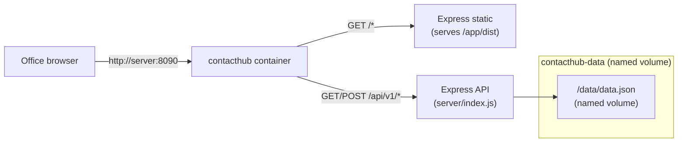
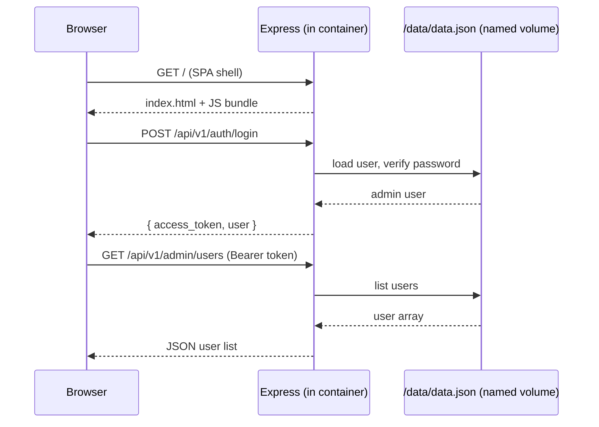

## Plan: Docker production setup (single container)

**TL;DR:** Build one `node:20-alpine` image that bundles the built React app and the Express API in a single Node process, exposing port `8090`. The image uses a named volume (`contacthub-data`) mounted at `/data` so `data.json` survives container rebuilds. A new `docker compose up -d` workflow replaces the current `npm run dev` for production.

**Architecture (single container)**

**Why single container:** you picked simplest ops. Express can both serve `dist/` and answer `/api/v1/*` from one process on one port, so there's only one container, one port, one volume to manage.

### Steps

1. **Make the API serve the React build (depends on 2).** Modify `server/index.js` so that when `NODE_ENV=production`, it serves `../dist` (or a configurable `STATIC_DIR`) as static files and falls back to `index.html` for SPA routes. Add a small mount block after all API routes so `/api/v1/*` still wins.
2. **Dockerize the build.** Add a multi-stage `Dockerfile`:
   - Stage 1 (`node:20-alpine` as `builder`): `npm ci` root deps, `npm --prefix server ci --omit=dev`, then `npm run build` to produce `dist/`.
   - Stage 2 (`node:20-alpine` as `runner`): copy `server/`, copy `dist/` from builder, copy a small `package.json` that only depends on `server/index.js`, expose `8090`, `CMD ["node", "server/index.js"]`.
   - Run as the built-in `node` user (alpine ships it) for safety.
3. **Pin production env.** Bake `NODE_ENV=production`, `PORT=8090`, `HOST=0.0.0.0`, and `DATA_FILE=/data/data.json` into the image via `ENV`. Leave `VITE_API_URL` unset so the SPA uses `window.location.hostname` (so `http://server:8090/api/v1` resolves automatically — no rebuild needed when the host changes).
4. **Compose file.** Add `docker-compose.yml` with one service `app` mapping `8090:8090`, the named volume `contacthub-data:/data`, `restart: unless-stopped`, and a `healthcheck` that `wget`s `/api/v1/health` (small new endpoint we'll add — see step 6).
5. **Trim the build context.** Add `.dockerignore` to exclude `node_modules`, `dist`, `.git`, `server/node_modules`, `*.log`, `.env*`. Speeds up builds and prevents leaking the dev `data.json` into the image.
6. **Add `/api/v1/health` to `server/index.js`.** Lightweight probe that returns `{ ok: true, ts }` (no auth). Used by Docker healthcheck and ops.
7. **Seed-on-empty-volume logic.** Confirm `loadData()` already auto-seeds an admin when `data.json` is missing — and that the path resolves to `/data/data.json` via the new `DATA_FILE` env var. Add an explicit `mkdirSync('/data', { recursive: true })` at boot so the named volume mounts cleanly on first run.
8. **Document the ops flow.** Update `README.md` with: building the image, `docker compose up -d`, accessing at `http://<server-lan-ip>:8090`, default admin credentials, backup command, restore command, log command (`docker compose logs -f`), and how to update after pulling new code (`docker compose up -d --build`).

### Relevant files

- `server/index.js` — add static-serve middleware, `/api/v1/health`, ensure `/data` exists, set defaults so `HOST=0.0.0.0`, `PORT=8090`, `DATA_FILE=/data/data.json` work without env.
- `server/package.json` — no change (already minimal `express` + `cors`).
- `Dockerfile` (new) — multi-stage build.
- `.dockerignore` (new) — trim context.
- `docker-compose.yml` (new) — single service + named volume.
- `README.md` — add a "Production (Docker)" section.
- `package.json` — add `"docker:build"` and `"docker:up"` scripts for convenience (optional).

### Diagrams

**Container data flow (already shown above)**

**Runtime request flow:**

### Verification

1. `docker compose build` — image builds, final stage is <250MB.
2. `docker compose up -d` — container starts, `docker compose ps` shows `healthy` within ~10s.
3. From the host: `curl http://localhost:8090/api/v1/health` returns `{"ok":true,...}`.
4. From the host: `curl -I http://localhost:8090/` returns `200` with `text/html`.
5. From a LAN PC: `http://<host-lan-ip>:8090` loads the React shell; login as `admin@corp.com` / `admin123` succeeds; refreshing keeps you logged in.
6. `docker compose down && docker compose up -d` — `data.json` survives (named volume persists); login still works without reseeding.
7. Backup: `docker compose exec app cat /data/data.json > backup-$(date +%F).json`.
8. Restore: `docker compose cp backup.json app:/data/data.json && docker compose restart app`.
